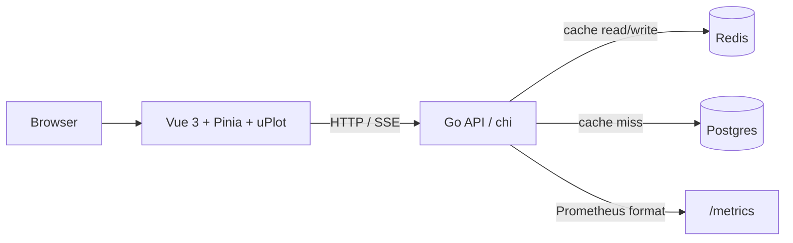

# Stampede Shield

Stampede Shield is a small-scale reproduction of the cache-stampede problem class. When many requests miss a cache at once, each request can repeat the same expensive database read, increasing latency and database load. This project is not a reproduction of any company's actual system; it is a deliberately bounded demonstration of the problem and its mitigations.

## Architecture



Postgres is initialized with one million feature rows. The API supports two runtime read paths:

- **Naive:** every cache miss performs its own Postgres query and then writes Redis.
- **Hardened:** coalesces misses with `singleflight`, uses detached 300 ms database contexts, applies up to 20% TTL jitter, and serves stale values while one background refresh runs.

## Run

Requirements: Docker with Compose. The optional load test also requires [k6](https://k6.io/).

```sh
docker compose up
```

Services:

| Service | URL |
|---|---|
| Dashboard | http://localhost:5173 |
| API | http://localhost:8080 |
| Prometheus metrics | http://localhost:8080/metrics |
| Metrics SSE | http://localhost:8080/metrics/stream |

The Postgres seed runs on first initialization of the `postgres-data` volume. To reseed from scratch, stop the stack and remove that named volume deliberately:

```sh
docker compose down -v
docker compose up
```

## API and experiments

Switch read paths without restarting:

```sh
curl -X POST 'http://localhost:8080/mode?value=naive'
curl -X POST 'http://localhost:8080/mode?value=hardened'
```

Read a feature and start a dashboard-visible burst:

```sh
curl http://localhost:8080/features/42
curl -X POST 'http://localhost:8080/loadgen/burst?rps=200&seconds=10&keys=10'
```

Inject controlled failures:

```sh
curl -X POST http://localhost:8080/chaos/flush-cache
curl -X POST 'http://localhost:8080/chaos/redis-down?seconds=15'
curl -X POST 'http://localhost:8080/chaos/db-latency?ms=250'
curl -X POST 'http://localhost:8080/chaos/db-latency?ms=0'
curl http://localhost:8080/chaos/state
```

Hardened mode can serve stale cache data immediately during a refresh failure. Database reads are capped at 100 in-flight operations; excess requests receive `429` and increment the load-shedding metric.

## Load testing

The Phase 1 baseline script is:

```sh
k6 run loadtest/burst.js
```

It ramps from steady traffic to a 10x spike. `API_HOST` can override the default API address:

```sh
API_HOST=localhost:8080 k6 run loadtest/burst.js
```

Run comparable experiments by switching modes, flushing the cache, and recording the k6 summary plus `/metrics` output. The repository currently includes `burst.js`; additional cold-start and Zipf/hot-key scripts remain follow-up work.

## Verification

Backend tests include the 1,000-request coalescing proof, TTL jitter bounds, stale refresh deduplication, and Redis-down fallback:

```sh
cd backend
go test ./...
go test -race ./...
```

Build the dashboard:

```sh
cd frontend
npm install
npm run build
```

## Benchmark results

No benchmark numbers are reported yet. The development environment could not start Docker and does not have k6 installed, so recording values would be fabrication. Fill this table only after running the same scenarios in both modes on the same machine.

| Scenario | Naive | Hardened |
|---|---:|---:|
| P99 latency under burst | pending measured run | pending measured run |
| DB QPS during cold start | pending measured run | pending measured run |
| Time to recover after cache flush | pending measured run | pending measured run |
| Error rate during Redis outage | pending measured run | pending measured run |

**Measurement environment:** pending Docker/k6 run. Record CPU model, RAM, OS, Docker version, Go version, k6 version, request rate, duration, key count, and whether the database/Redis volumes were warm.

## Design decisions and tradeoffs

- **Singleflight:** eliminates duplicate same-key reads inside one API process. It is process-local; multiple API replicas would need a distributed coordination strategy.
- **Detached context:** the shared database read uses its own timeout so one impatient HTTP client cannot cancel work needed by other callers.
- **TTL jitter:** spreads expirations for entries written together, reducing synchronized misses. It makes exact expiration times less predictable.
- **Stale-while-revalidate:** favors availability and latency over freshness after soft expiry. The hard TTL still bounds how long an entry can remain available.
- **Load shedding:** rejects work once database capacity is full instead of allowing an unbounded queue to amplify latency.
- **Redis fallback:** cache errors do not prevent a successful database response. Without a stale value, database availability still determines the result.

## What I'd do next

- Add probabilistic early expiration and per-key rate limits.
- Add the cold-start and Zipf-distributed k6 scenarios.
- Move coordination to a distributed mechanism for multi-replica deployments.
- Evaluate ScyllaDB or another horizontally scalable backing store.
- Add multi-region cache placement and failure-domain testing.

## Demo

`[Demo GIF placeholder]`
